# Calculator question hierarchy

Sirf questions aur options. Arrow tab hai jab option agla sawal badalta hai. Jo options flow nahi badalte, woh usi question ke box mein hain.

Source: calculator journey (`client/src/lib/investorJourney.ts`).

## Start

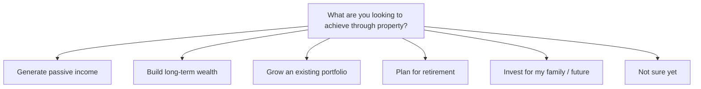

---

## Generate passive income

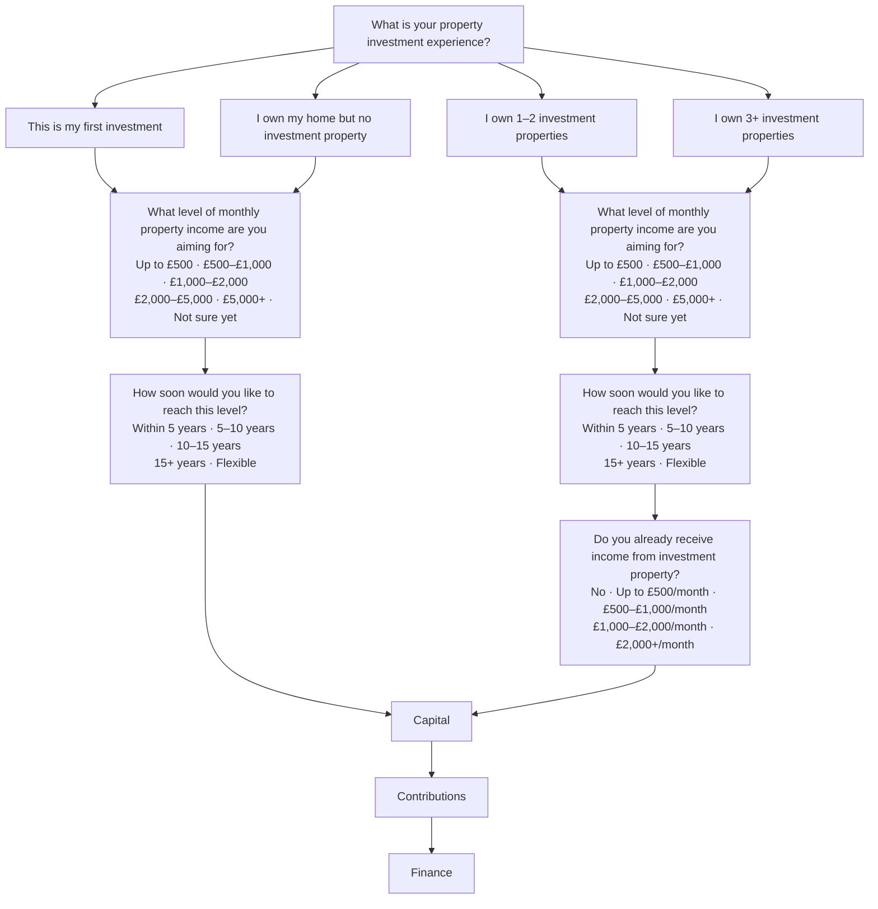

---

## Build long-term wealth

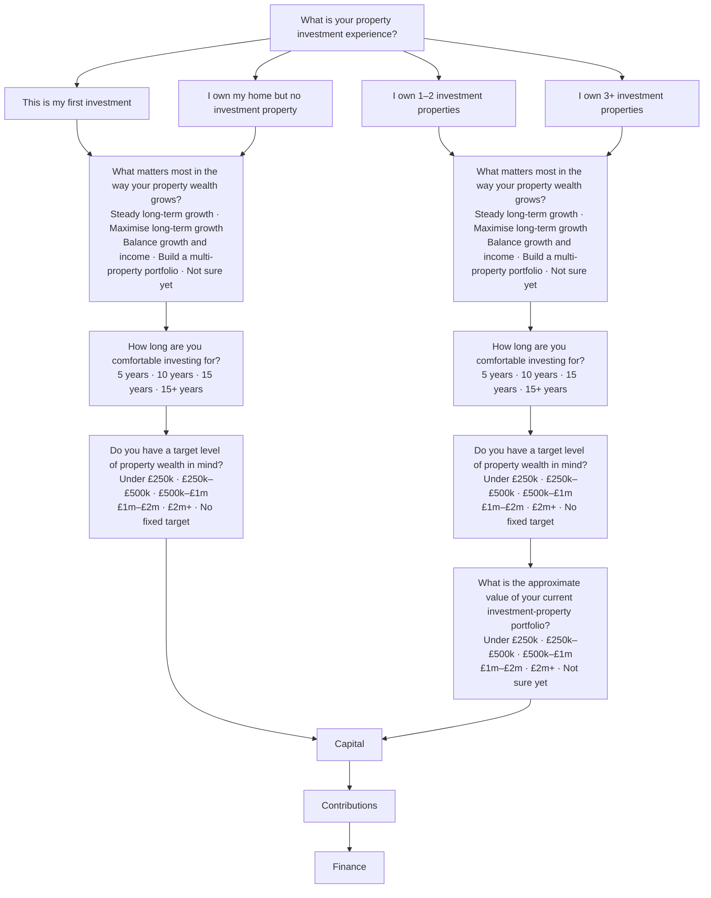

---

## Grow an existing portfolio

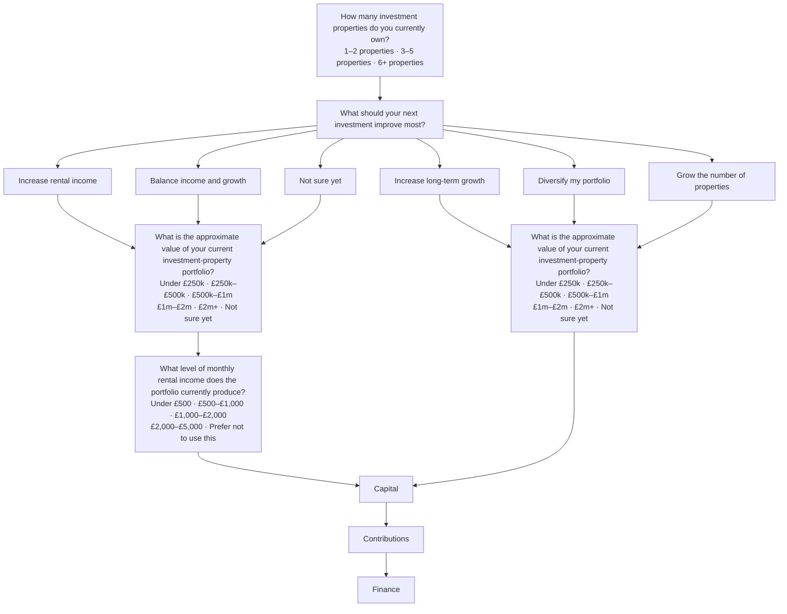

---

## Plan for retirement

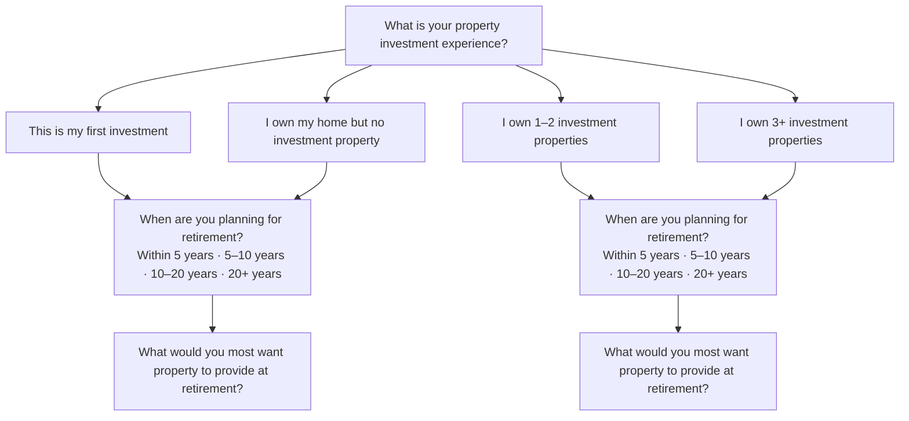

### First investment, or home only

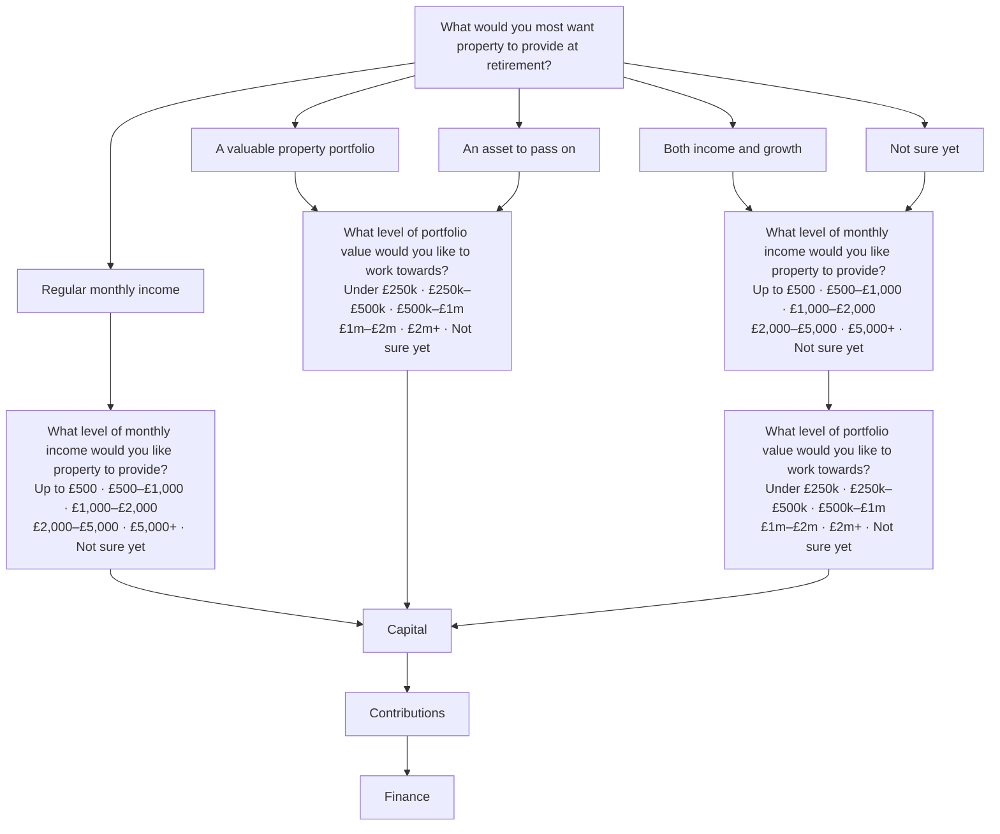

### Owns 1–2 or 3+ investment properties

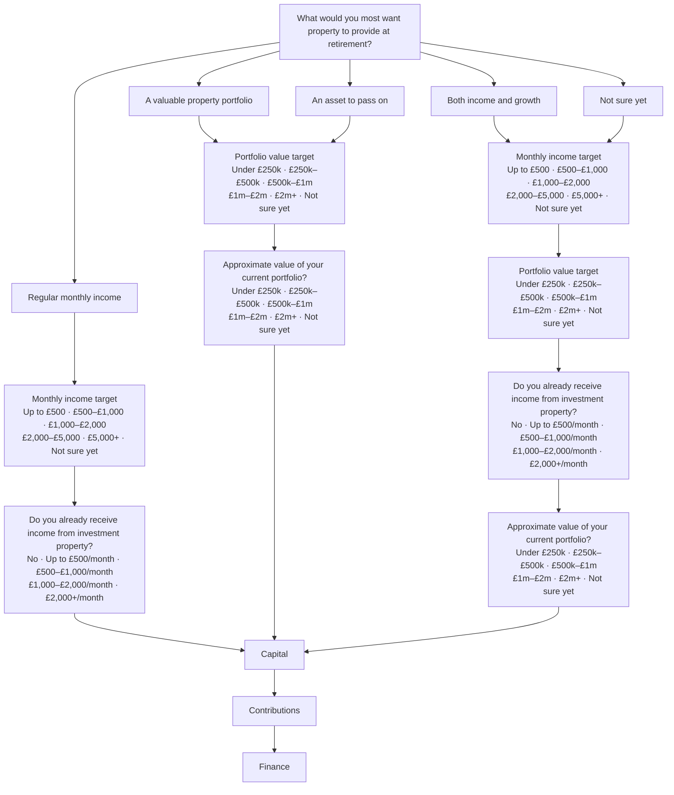

---

## Invest for my family / future

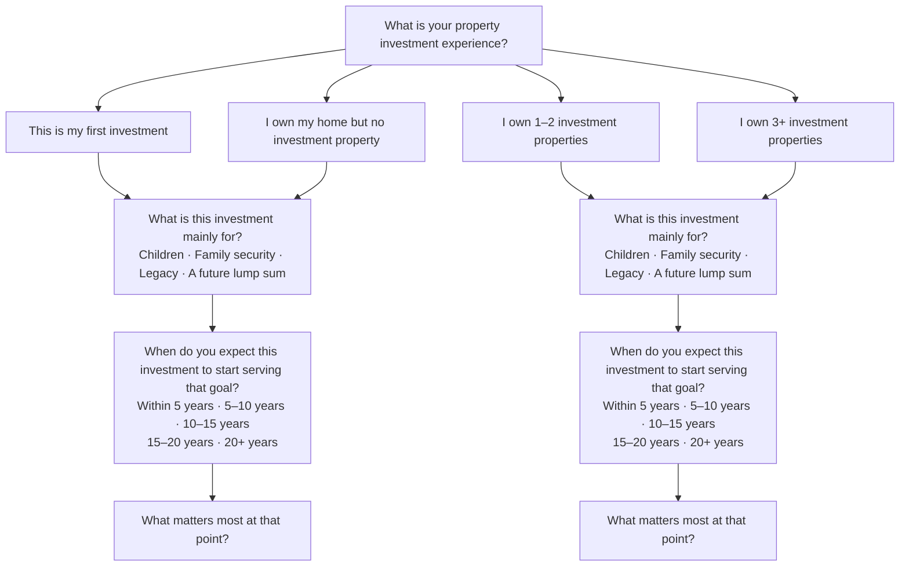

### First investment, or home only

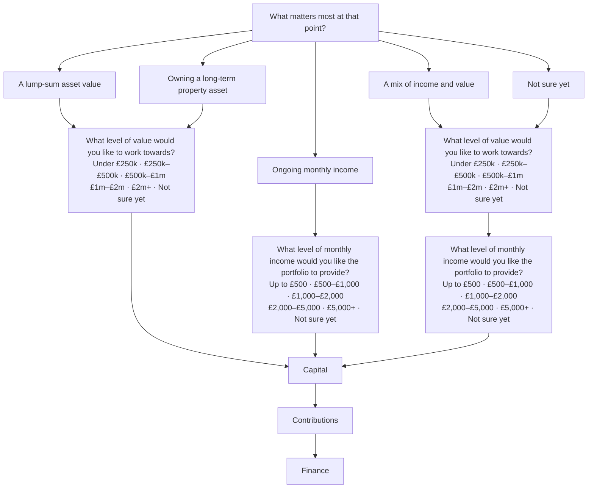

### Owns 1–2 or 3+ investment properties

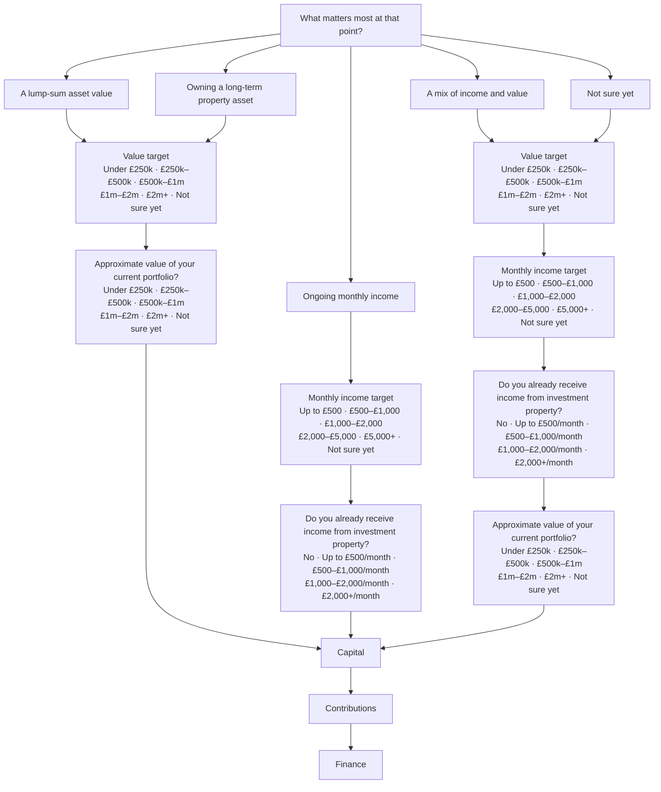

---

## Not sure yet

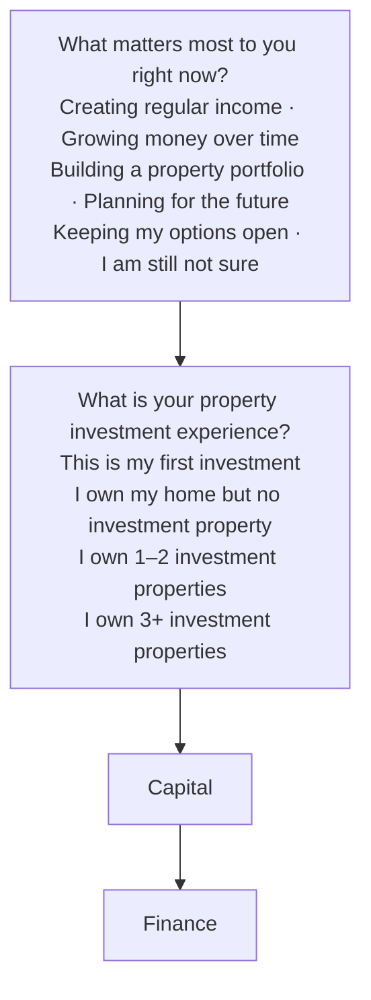

Contributions is path par nahi aata.

---

## Capital, Contributions, Finance

Yeh har goal ke end par aata hai, Not sure yet ke ilawa. Not sure yet par Contributions skip hota hai.

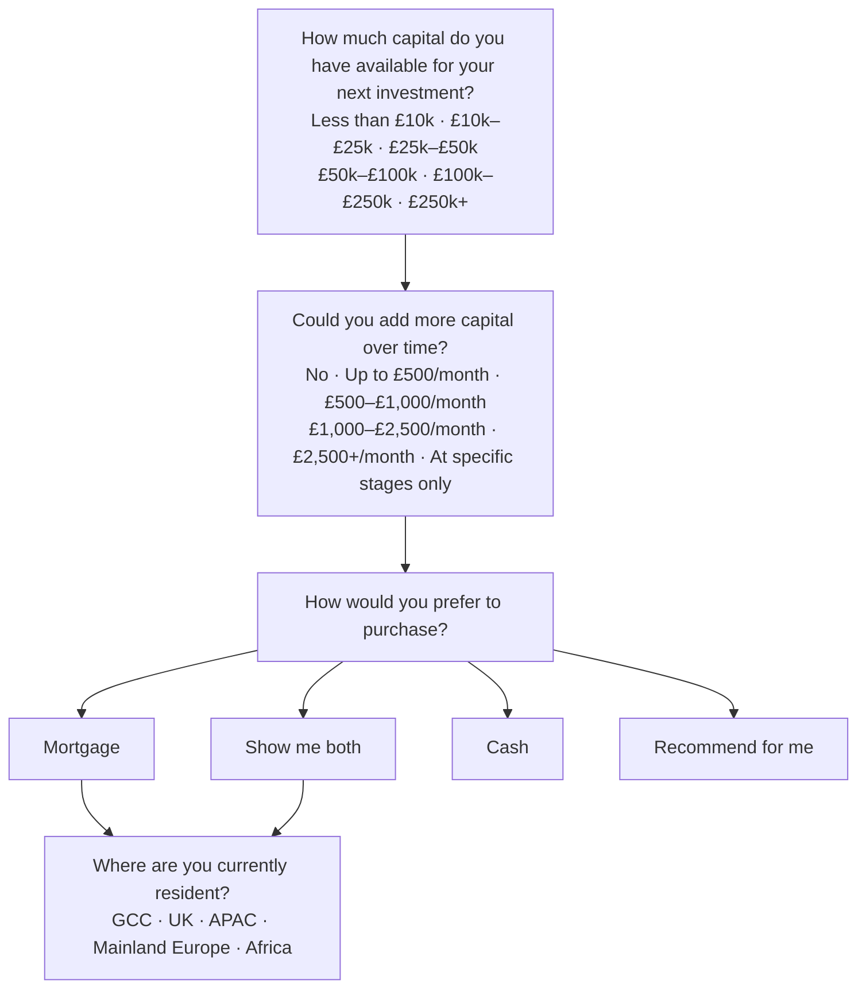

Cash aur Recommend for me ke baad residency ka sawal nahi aata.
